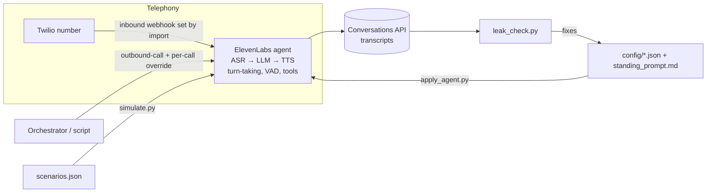

# voice-agent-playbook

**A production-tuned AI phone assistant on ElevenLabs Conversational AI + Twilio: config-as-code, per-call overrides, scenario simulation, and an automated transcript QA check.**

## The problem
Getting a voice agent to *demo* is easy. Getting one that real people don't hang up on is not. On live calls the first version:
- read its own reasoning and style tags out loud ("the user is asking...", "[casual]"),
- heard its own intro over speakerphone and treated it as an interruption,
- said "oh, gotcha" to dead air,
- sat in a carrier voicemail menu for 4+ minutes,
- and got the number flagged as spam after a burst of test dials.

This repo is the fixed version: the settings, the prompt, the scripts, and the QA loop that caught each problem.

## What it does
- **`config/agent_config.example.json`** – the tuned agent (LLM, TTS, ASR, turn-taking, VAD, built-in tools, override permissions) as code.
- **`config/standing_prompt.md`** – the permanent prompt, led by a **"Spoken output only"** block that stops reasoning/tag leaks.
- **`scripts/apply_agent.py`** – dry-run or create/PATCH the agent from config.
- **`scripts/outbound_call.py`** – one outbound call with a **per-call prompt override** (the standing prompt is never edited). Auto-prepends the no-leak block. Dry run unless `--confirm`.
- **`scripts/simulate.py`** + **`config/scenarios.json`** – 8 adversarial caller scenarios (suspicious callee, "hold on", wrong number, heavy interrupter, "are you AI?", "stop calling") via the simulate-conversation API, no dialing.
- **`scripts/leak_check.py`** – regex QA on transcripts: tag leaks, reasoning leaks, tool-label leaks, recap-after-interrupt, filler-on-silence. Non-zero exit on failure so it can gate a CI job.
- **`SETUP.md`** – the full build guide: number import, settings, overrides, transcripts, SMS/A2P 10DLC lessons, testing checklist, gotchas.

## Architecture


## Run it
```bash
cp .env.example .env && set -a && . ./.env && set +a
python3 scripts/apply_agent.py                 # dry run: see the payload
python3 scripts/apply_agent.py --apply         # create or update the agent
python3 scripts/simulate.py config/scenarios.json
python3 scripts/outbound_call.py --to +1555010XXXX --name Sam --prompt-file my_task.md   # dry run
python3 scripts/leak_check.py examples/*.txt
```
Only dial numbers you own while testing, and space test calls out (see SETUP.md, "Spam flag").

## Example output
`python3 scripts/leak_check.py examples/sample_transcript.txt examples/bad_transcript.txt`
```json
[
  {"file": "sample_transcript.txt", "agent_turns": 4, "issues": [], "pass": true},
  {"file": "bad_transcript.txt", "agent_turns": 2, "pass": false, "issues": [
    {"turn": 1, "check": "tag_leak", "text": "[casual] Hey, this is Avery."},
    {"turn": 3, "check": "reasoning_leak", "text": "The user is asking who I am. I should explain that I'm the assistant."}]}
]
```

## Key lessons (details in SETUP.md)
| Problem on live calls | Fix |
|---|---|
| Model speaks its reasoning / `[tags]` | "Spoken output only" block at the top of *every* prompt; phoneme tags off; no style tags anywhere |
| Speakerphone echo of her own intro = interruption | Her name in `interruption_ignore_terms` + background voice detection |
| "Oh gotcha" to silence | Soft-timeout fillers off |
| Stuck in voicemail menus | `voicemail_detection` tool + "one message, then hang up" rule |
| Dead air mid-call | Preload everything in the per-call override; no mid-call lookups |
| Number flagged as spam | Space out test dials; register Voice Integrity / CNAM |

## License
MIT
